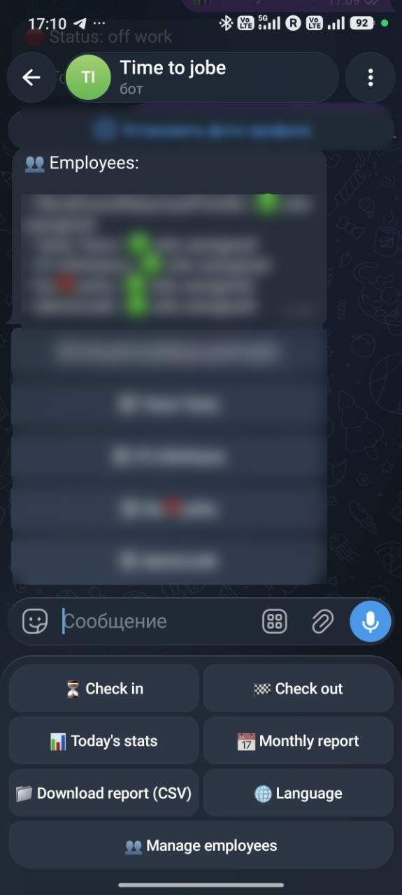
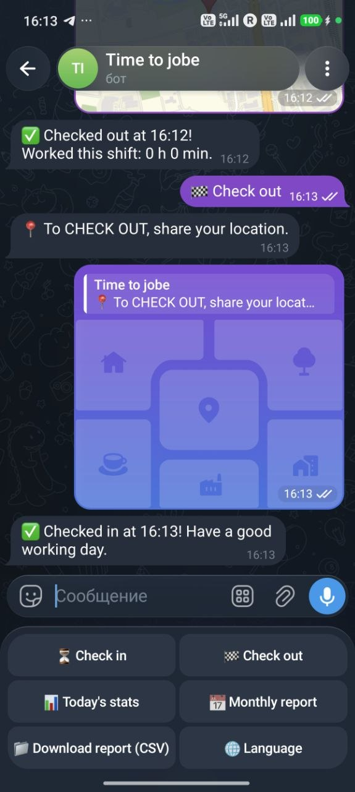
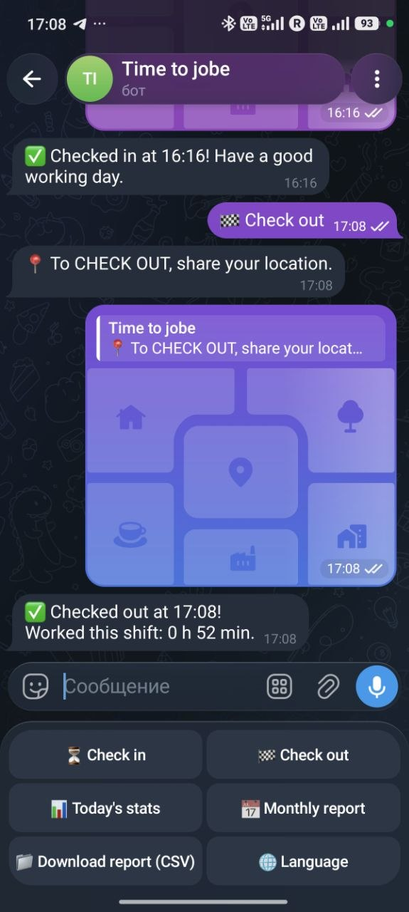
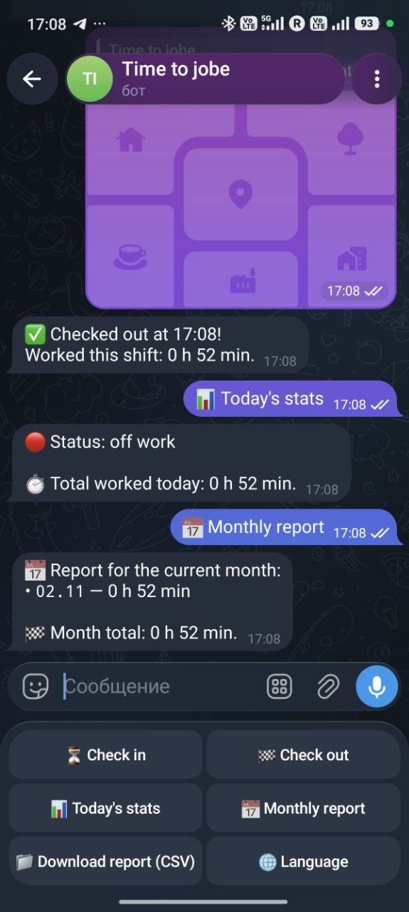
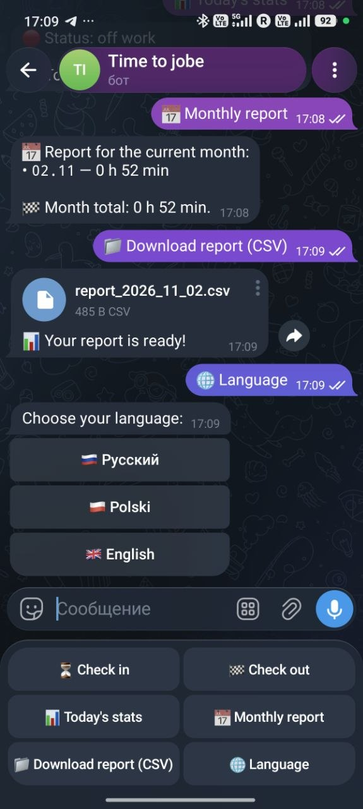
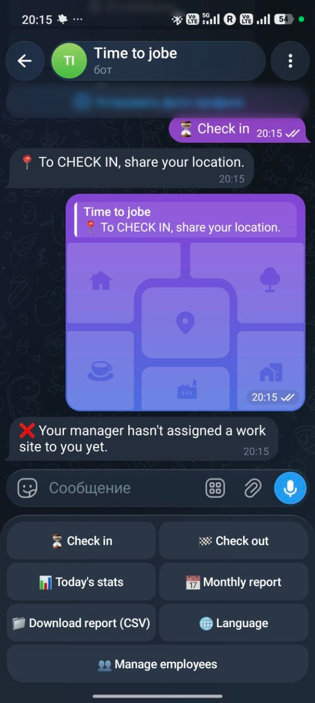
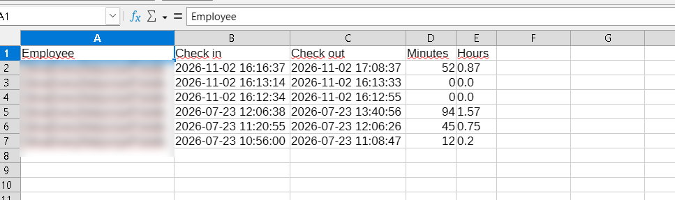

# TimeOfWork — Telegram bot for work time tracking

A Telegram bot for small teams (e.g. construction crews) that records when employees **start and finish work** — and only accepts the check-in when the employee is **physically at the assigned work site**, verified by geolocation.

> Source code is private. Available for review on request.

## Screenshots

<table>
  <tr>
    <td align="center"> Admin panel and main menu</td>
    <td align="center"> Check-in at the work site</td>
    <td align="center"> Check-out with shift duration</td>
  </tr>
  <tr>
    <td align="center"> Daily stats and monthly report</td>
    <td align="center"> CSV export and language switch</td>
    <td align="center"> Check-in blocked — no work site assigned</td>
  </tr>
  <tr>
    <td align="center" colspan="3"> CSV report in a spreadsheet</td>
  </tr>
</table>

## Features

- **Check-in / check-out with geolocation** — distance to the work site is calculated with the haversine formula; check-in is rejected outside the allowed radius (150 m by default)
- **Admin panel inside Telegram** — the manager assigns a work site to each employee by sending a location or typing coordinates
- **Statistics** — hours worked today (including the open shift) and a monthly report by day
- **CSV export** — the manager gets a report for the whole team, an employee only their own; opens correctly in Excel
- **Three interface languages** — English, Polish and Russian, detected from Telegram settings and switchable in the bot

## How it works

1. An employee sends `/start` and gets registered.
2. The manager assigns a work site to the employee.
3. The employee taps **"Check in"** and shares their location. If they are within the radius, the shift starts.
4. At the end of the day they tap **"Check out"** — the shift is closed and its duration is saved.
5. Reports are available in the chat or as a CSV file.

## Tech stack

- **Python 3.11+**, **aiogram 3** (async Telegram Bot API)
- **SQLite** with schema migration
- Modular architecture: configuration, geolocation, database and reports separated from bot handlers
- **pytest** — 35 unit tests (geolocation, shifts, reports, translation consistency)
- **GitHub Actions** — automated tests on every push
- Secrets in environment variables, never in code
- Windows build with PyInstaller

---

### 🇵🇱 Po polsku

**TimeOfWork** to bot Telegram do ewidencji czasu pracy dla małych zespołów. Pracownik rejestruje wejście i wyjście, a bot sprawdza geolokalizację — rejestracja jest możliwa tylko na terenie przypisanego obiektu. Kierownik przypisuje obiekty pracownikom i pobiera raporty CSV. Interfejs po angielsku, polsku i rosyjsku. Kod źródłowy jest prywatny, dostępny do wglądu na prośbę.

---

© AYS Soft
